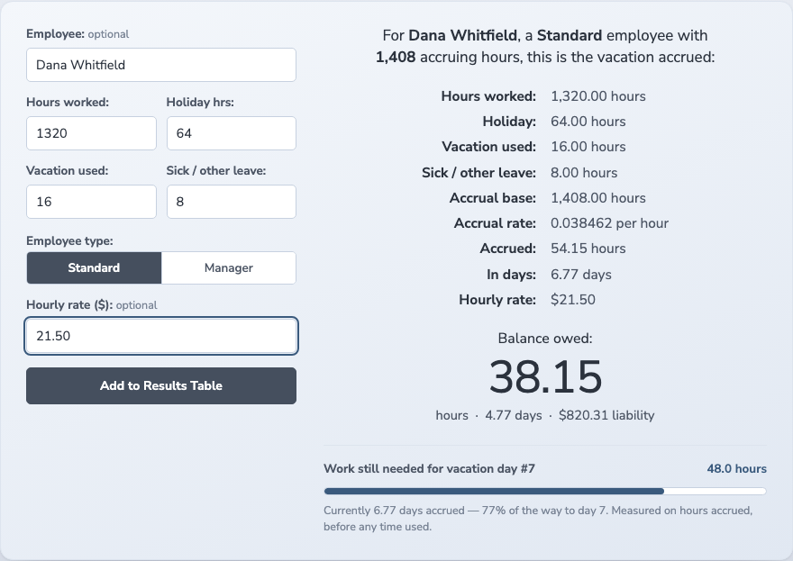
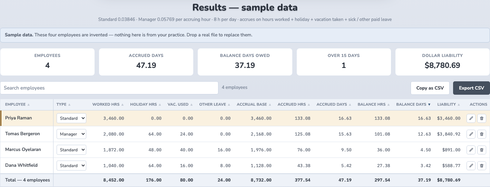

# Vacation Accrual Calculator

A single-page tool that turns **hours worked** into **accrued vacation hours, days and dollar
liability** — for one employee at a time, or for a whole payroll export.

**[Open the calculator →](https://sweetie222.github.io/Vacation-accrual-calculator/)**

It is a plain static page. No build step is required to run it, no server, no accounts, and no
data ever leaves the browser.





## Quick start

Open `index.html` in a browser. That's it.

To serve it over HTTP instead (needed only if you want to load it on a phone on the same network):

```sh
npm run serve      # http://localhost:8080
```

## What it does

**Quick calculate** — type one employee's hours and read back the accrued hours, the accrued days,
the balance owed and, if you give an hourly rate, the dollar liability. It also shows how many more
hours that person has to work to reach their next whole vacation day.

**Upload payroll** — drop a CSV, TSV or `.xlsx` export, map your columns to the fields the
calculator needs, and get a sortable, searchable table with totals, a CSV export, and a highlight
on anyone sitting on an unusually large balance. If the file has one row per pay period rather than
one per employee, tick **Combine rows by employee name** and the hours are summed.

Every row can be edited or removed. Removals are recoverable, and edited or hand-added rows are
labelled, so an exported report never silently disagrees with the file it came from.

## How the calculation works

```
accrual rate   = annual vacation hours ÷ annual full-time hours     (e.g. 80 ÷ 2080)
accrual base   = hours worked + whichever paid-hour types your policy counts
accrued hours  = accrual base × accrual rate
accrued days   = accrued hours ÷ hours per vacation day             (default 8)
balance        = accrued hours − vacation hours already used
liability ($)  = balance × hourly rate
```

The rate is always kept as the exact fraction, never a rounded decimal, so a full-time year lands
on the annual allowance to the cent rather than on 79.99.

All of it is configurable under **Policy settings**: the standard and manager annual allowances,
the full-time year, the hours in a vacation day, and the threshold at which a balance gets flagged.

## Which hours earn accrual

This is the setting to get right, and **no law decides it for you.**

- Federal law does not require paid vacation, holidays or sick leave at all, so there is no federal
  rule about what earns accrual. The US Department of Labor's position is that these are
  "matters of agreement between an employer and an employee."
- "Hours worked" is nevertheless a defined term under the FLSA, and paid leave is explicitly *not*
  in it — holiday, vacation and sick hours do not count toward the 40-hour overtime threshold. So
  if a handbook says "per hour worked", the conventional reading excludes them.
- The one place law does fix a basis is state paid-sick-leave minimums (1 hour per 30 hours worked
  in California, Arizona, Colorado, Minnesota and New Jersey; 1 per 40 in Washington). Those are
  measured on hours *actually worked*, so the strict setting never falls below them.
- What binds an employer is its own written policy. In several states, California in particular,
  accrued vacation is treated as earned wages that cannot be clawed back.

So **set this to match the handbook.** Counting all paid hours is the more generous and widely used
choice, and it avoids the circular result where taking vacation slows down earning vacation;
counting only hours worked is equally lawful. The basis in force is printed on the results header
and written into the CSV export, so a saved report always states what produced it.

> **Watch for double counting.** If the "hours worked" column in your payroll export is really
> "total hours paid", it already includes holiday and vacation. Counting those again would credit
> them twice.

This is not legal advice. For the handbook wording itself, ask an employment attorney.

## Privacy

Everything runs in the browser. Uploaded files are parsed in memory and never sent anywhere, to
this project or to anyone else. Exporting hands the CSV directly to the browser's own download.

So your work survives a reload, the results table is also written to `localStorage` **on that
computer**. It never syncs, never reaches a server, and is readable only by that browser profile.
A checkbox under the table turns it off, and **Clear saved data** wipes it. In a private window or
with site data blocked it degrades to in-memory only, and says so.

**Do not enable it on a shared front-desk machine**, and do not commit exported payroll CSVs to a
repository — `.gitignore` blocks `*.csv`, `*.xlsx` and `*.xls` for that reason.

The only outbound requests the page makes are for the web font (Google Fonts) and the spreadsheet
reader (cdnjs), both at load time. Neither receives any payroll data. Delete those two `<link>` and
`<script>` tags if you want a page that talks to nothing at all — you lose the custom font and
`.xlsx` support, and CSV keeps working.

## Project layout

```
index.html            markup
assets/styles.css     all styling, light and dark themes
assets/accrual.js     accrual maths — rates, base, balance, liability. No DOM.
assets/payroll.js     CSV/TSV parsing, header and column guessing. No DOM.
assets/app.js         interface: wiring, rendering, file handling
test/                 node:test suites for the two logic modules
build.js              inlines everything into dist/ as one shareable file
```

`accrual.js` and `payroll.js` hold the logic and touch no browser API, which is what makes them
testable. They export a global (`Accrual`, `Payroll`) in the browser and a CommonJS module in Node.

## Development

```sh
npm test       # 22 assertions over the accrual maths and the file parsing
npm run build  # dist/vacation-accrual-calculator.html — one self-contained file
```

There are no dependencies and no toolchain; the tests use Node's built-in runner. The build exists
only to produce a single file to email or drop on a shared drive — the split source is what you
edit, and it runs directly from `index.html` without building.

## Deploying

Served by GitHub Pages from `main` at the repository root, at
<https://sweetie222.github.io/Vacation-accrual-calculator/>. There is no workflow file and no build
step — pushing to `main` republishes the site, because the page runs straight from source.

To host it elsewhere, any static host will do, or run `npm run build` and drop the single file from
`dist/` anywhere at all.

## Browser support

Any current Chrome, Edge, Firefox or Safari. It uses `<dialog>` for the row editor, CSS custom
properties for theming, and `sticky` table headers.

## License

MIT — see [LICENSE](LICENSE). Replace the placeholder copyright holder with your name.
